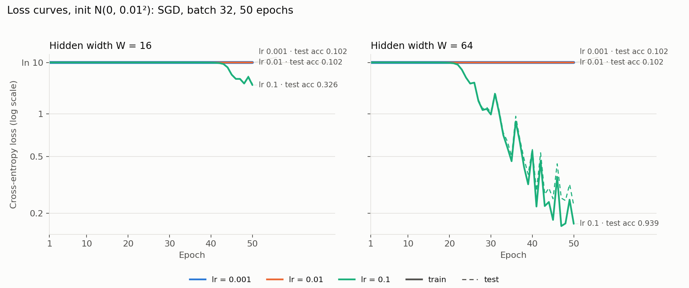
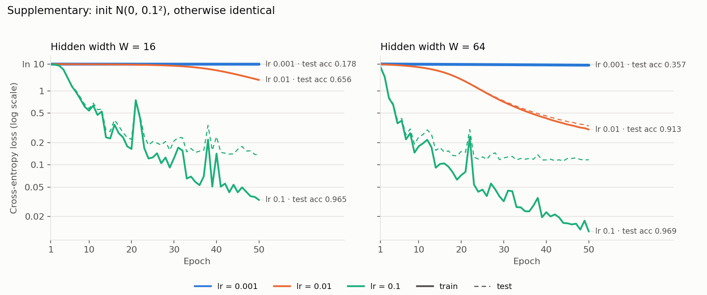

# Lab 2: A neural network from scratch

## 1. Goal

Build a two-hidden-layer neural network in plain NumPy for handwritten-digit classification. Implement forward propagation, cross-entropy loss and backpropagation by hand, and prove the hand-derived gradients correct with numerical gradient checking. Then train it across learning rates and hidden widths, and measure how the cost of one training step splits between the forward and the backward pass.

## 2. Method

**Environment.** Python 3.11.8 in the repo `.venv`; versions in `results/versions.txt`. Apple M5 (10 cores), CPU only; NumPy 1.26.4 uses OpenBLAS (up to 3 threads). All arithmetic is float64. Seeds are set for `random`, NumPy and PyTorch. Weight initialisation and shuffling use `np.random.default_rng(42)`. All results are reproduced with `src/run_all.sh`.

**Data.** `load_digits` gives 1,797 8×8 images (64 features, pixel values 0–16). Inputs are divided by 16 so they lie in [0, 1]. Labels are one-hot encoded into 10 columns. A 70/30 stratified split with `random_state=42` leaves 1,257 training and 540 test samples.

**Network design.** The network is 64 → W → ReLU → W → ReLU → 10 → softmax, with W ∈ {16, 64}. B is the batch size.

| Layer | Weight | Bias | Output | Parameters (W = 16) | Parameters (W = 64) |
|---|---|---|---|---|---|
| Hidden 1 | (64, W) | (W,) | Z1, A1 = ReLU(Z1): (B, W) | 1,040 | 4,160 |
| Hidden 2 | (W, W) | (W,) | Z2, A2 = ReLU(Z2): (B, W) | 272 | 4,160 |
| Output | (W, 10) | (10,) | Z3 → P = softmax(Z3): (B, 10) | 170 | 650 |
| **Total** | | | | **1,482** | **8,970** |

Weights are drawn from N(0, 0.01). The manual's notation does not say whether 0.01 is the standard deviation or the variance. I followed NumPy's `normal(loc, scale)` convention and used **standard deviation 0.01**. A supplementary run with standard deviation 0.1 (variance 0.01) covers the other reading. Biases start at zero.

**Forward pass and loss.** Each layer computes Z = A·W + b, followed by ReLU or softmax. Softmax subtracts each row's maximum before exponentiating to avoid overflow, which does not change its output. The loss is the batch-mean cross-entropy L = −(1/B) Σ log P[i, yᵢ].

**Gradients (chain rule, derived by hand).** Softmax and cross-entropy combine into one simple expression, dL/dZ3 = (P − Y)/B. Working back layer by layer, with ⊙ for element-wise product and 1[·] for the ReLU derivative:

| Step | Gradient |
|---|---|
| Output layer | dW3 = A2ᵀ·dZ3, db3 = column sums of dZ3 |
| Into hidden 2 | dA2 = dZ3·W3ᵀ, dZ2 = dA2 ⊙ 1[Z2 > 0] |
| Hidden 2 | dW2 = A1ᵀ·dZ2, db2 = column sums of dZ2 |
| Into hidden 1 | dA1 = dZ2·W2ᵀ, dZ1 = dA1 ⊙ 1[Z1 > 0] |
| Hidden 1 | dW1 = Xᵀ·dZ1, db1 = column sums of dZ1 |

No gradient with respect to the input X is needed.

**Gradient check.** For each width, 10 weights are drawn at random from W1, W2 and W3. Each one is nudged by ±1e-5, and the central difference [L(w+ε) − L(w−ε)] / 2ε is compared with the analytic gradient. The relative error is |a − n| / max(|a|, |n|). I also record whether a nudge flips any ReLU on or off (a "kink"), since the loss is not differentiable there. Two design choices, both motivated by the sweep in §3.2:
1. **The check uses one training sample.** The backpropagation formulas do not depend on the batch size, because a batch only averages them. But averaging over a batch shrinks the gradients toward the numerical noise floor.
2. **The 10 weights are drawn from those with a non-zero analytic gradient.** Zero gradients come from always-blank border pixels or inactive ReLUs. There both slopes are exactly 0 and the check carries no information.

The draw uses a fixed seed (42) and was not re-rolled.

**Training.** Plain mini-batch SGD with batch size 32 (the last batch of each epoch has 9 samples), 50 epochs, and a reshuffle every epoch. Learning rates are {0.001, 0.01, 0.1} and widths {16, 64}. For a fair comparison, every learning rate of a given width starts from the same initial weights and sees the same shuffle order. Train and test loss and accuracy on the full sets are logged after every epoch (`results/train_log.csv`, `results/train_stdout.txt`).

**Timing.** Forward and backward are timed separately with `time.perf_counter`: 1 warm-up, then 100 runs, and the median is reported. The backward timing reuses a cached forward pass. Both are measured at the training batch size (32) and on the whole training set (1,257). To connect the timings to matrix multiplication, each pass is also timed with only its matrix multiplications (same shapes, nothing else), and matmul FLOPs are counted as 2·m·n·k per product.

## 3. Results

### 3.1 Forward pass and initial loss (`results/sanity_checks.csv`)

| Width | Output shape (full train set) | max \|row sum − 1\| | Untrained loss | ln 10 |
|---|---|---|---|---|
| 16 | (1257, 10) ✓ | 4.4e-16 ✓ | 2.3026 | 2.3026 |
| 64 | (1257, 10) ✓ | 3.3e-16 ✓ | 2.3026 | 2.3026 |

Every row of P sums to 1 within 1e-15, far inside the required 1e-6. The untrained loss equals ln 10 to four decimals, because small random weights give almost identical logits for all classes, so the softmax output is nearly uniform at 0.1 per class.

### 3.2 Gradient check (`results/gradient_check.csv`)

**Passed for both widths: W = 16 has 9/10 weights below 1e-6, and W = 64 has 10/10.** No nudge crossed a ReLU kink.

| W = 16 | Analytic | Numerical | Rel. error | | W = 64 | Analytic | Numerical | Rel. error |
|---|---|---|---|---|---|---|---|---|
| W1[11, 14] | −3.2515e-05 | −3.2515e-05 | 1.8e-07 | | W1[13, 54] | −3.9928e-04 | −3.9928e-04 | 2.8e-09 |
| **W3[3, 4]** | 7.9342e-06 | 7.9342e-06 | **1.1e-06 ✗** | | W2[57, 25] | −1.7690e-04 | −1.7690e-04 | 4.3e-08 |
| W1[11, 15] | 6.2805e-04 | 6.2805e-04 | 7.7e-10 | | W1[18, 4] | −1.2989e-04 | −1.2989e-04 | 7.2e-08 |
| W2[8, 15] | −8.6862e-05 | −8.6862e-05 | 1.7e-07 | | W2[42, 48] | −2.1513e-04 | −2.1513e-04 | 1.6e-08 |
| W1[46, 8] | 4.4548e-05 | 4.4548e-05 | 2.3e-07 | | W2[4, 56] | −1.8567e-04 | −1.8567e-04 | 1.8e-08 |
| W1[46, 0] | 4.4969e-05 | 4.4969e-05 | 2.8e-07 | | W2[4, 39] | 6.3489e-05 | 6.3489e-05 | 5.2e-08 |
| W2[11, 15] | −1.5656e-04 | −1.5656e-04 | 2.9e-08 | | W2[51, 17] | −1.2105e-04 | −1.2105e-04 | 1.3e-07 |
| W1[12, 8] | 2.0789e-04 | 2.0789e-04 | 5.4e-08 | | W1[18, 37] | 6.6210e-04 | 6.6210e-04 | 1.1e-10 |
| W1[26, 8] | 2.3759e-04 | 2.3759e-04 | 1.3e-08 | | W1[33, 60] | 1.1825e-05 | 1.1825e-05 | 2.1e-07 |
| W3[10, 0] | −1.5840e-03 | −1.5840e-03 | 7.7e-09 | | W3[16, 8] | 2.5220e-04 | 2.5220e-04 | 1.6e-08 |

The single failure has the smallest gradient in the table (7.9e-6). Its absolute error, 8.8e-12, is the same size as everyone else's.

**Why the check was set up this way** (`results/gradient_check_sweep.csv`). This sweep draws 400 uniformly random weights per configuration:

| Width | Batch | Non-zero gradients | Pass rate (non-zero) | Median \|gradient\| | Median \|analytic − numerical\| | ReLU kinks crossed |
|---|---|---|---|---|---|---|
| 16 | 1 | 39% | 94% | 1.1e-04 | 7.2e-12 | 0 |
| 16 | 4 | 44% | 81% | 4.3e-05 | 9.3e-12 | 5 |
| 16 | 32 | 73% | 61% | 1.5e-05 | 9.1e-12 | 5 |
| 64 | 1 | 31% | 99% | 1.3e-04 | 7.6e-12 | 0 |
| 64 | 4 | 59% | 91% | 5.9e-05 | 7.0e-12 | 0 |
| 64 | 32 | 78% | 67% | 2.1e-05 | 8.9e-12 | 2 |

The absolute disagreement stays at about 1e-11 whatever the batch size. This is the floor of the central difference itself: rounding error in a float64 loss of about 2.3, divided by 2ε = 2e-5. The relative error is therefore roughly 1e-11 / |gradient|, so a gradient must be at least about 1e-5 to pass the 1e-6 threshold. With N(0, 0.01) weights and a batch of 32, the median gradient is only 1.5–2.1e-5, right at that edge. So most "failures" at B = 32 come from the measuring tool, not from the backpropagation code. A single sample gives about 10× larger gradients and crossed no kinks.

### 3.3 Training (`results/loss_curves.png`, `results/test_accuracy.csv`)

| Width | lr | Final train loss | Final test loss | **Final test accuracy** |
|---|---|---|---|---|
| 16 | 0.001 | 2.3025 | 2.3026 | 0.1019 |
| 16 | 0.01 | 2.3025 | 2.3025 | 0.1019 |
| 16 | 0.1 | 1.5970 | 1.6237 | 0.3259 |
| 64 | 0.001 | 2.3025 | 2.3025 | 0.1019 |
| 64 | 0.01 | 2.3023 | 2.3023 | 0.1019 |
| 64 | 0.1 | 0.1684 | 0.2271 | **0.9389** |

With standard deviation 0.01, five of the six runs never leave the ln 10 plateau and predict a single class (10.2% accuracy, the share of the most common class in the test set). Only lr = 0.1 escapes it: W = 64 begins to fall around epoch 21 and reaches 93.9%, while W = 16 does not start until around epoch 42 and ends at 32.6%. Once it escapes, the W = 64 curve is spiky, which suggests 0.1 is close to the largest stable step size.

**Supplementary: the other reading of N(0, 0.01)** (standard deviation 0.1; `results/loss_curves_std0.1.png`, `results/test_accuracy_std0.1.csv`)

| Width | lr = 0.001 | lr = 0.01 | lr = 0.1 |
|---|---|---|---|
| 16 | 0.1778 | 0.6556 | 0.9648 |
| 64 | 0.3574 | 0.9130 | **0.9685** |

Test accuracy after 50 epochs. Everything else is identical to the graded run. All six runs now learn, and the ranking by learning rate and width is the same as before. At lr = 0.1 the test loss stops improving after about epoch 25 and ends at 0.12–0.14, apart from occasional spikes up to 0.34 for W = 16. Meanwhile the training loss keeps falling to 0.01–0.03, so the network is starting to overfit.

### 3.4 Forward vs. backward timing (`results/timing.csv`)

Medians of 100 runs, in microseconds:

| Width | Batch | Forward | Backward | Backward / forward | Forward matmuls only | Backward matmuls only | Matmul FLOPs, fwd → bwd (M) | FLOP ratio |
|---|---|---|---|---|---|---|---|---|
| 16 | 32 | 18.9 | 20.4 | 1.08 | 6.4 | 9.6 | 0.09 → 0.12 | 1.29 |
| 16 | 1257 | 280.0 | 324.6 | 1.16 | 90.4 | 194.5 | 3.6 → 4.7 | 1.29 |
| 64 | 32 | 62.2 | 65.7 | 1.06 | 28.1 | 43.7 | 0.57 → 0.87 | 1.54 |
| 64 | 1257 | 601.8 | 1014.9 | **1.69** | 318.8 | 956.0 | 22.2 → 34.1 | 1.54 |

**The backward pass dominates, and the gap comes from matrix multiplication.**
- **Forward** does 3 matmuls: X·W1, A1·W2 and A2·W3.
- **Backward** does 5 matmuls, because each layer needs both a weight gradient (Aᵀ·dZ) and a gradient for the layer below (dZ·Wᵀ). Only the first layer skips the second product, since nothing needs dL/dX.
- **FLOP count:** backward therefore costs 1.29× the forward FLOPs at W = 16 and 1.54× at W = 64. The W×W product in the middle layer is counted twice in backward, so the ratio grows with width and approaches 2 for large W.
- **Large batches:** on the full training set, the measured time ratio (1.16 and 1.69) roughly follows the FLOP ratio. Matmuls are 32–53% of forward time and 60–94% of backward time. The backward matmuls take 2.2–3.0× the forward matmuls' time, which is more than their FLOP ratio. The transposed operands (Aᵀ·dZ, dZ·Wᵀ) are likely read less cache-efficiently.
- **Training batch of 32:** forward and backward cost almost the same (1.06–1.08×). With matrices this small, each NumPy call's fixed overhead weighs about as much as the arithmetic. For W = 16, matmuls are only a third of the forward time.
- **Run-to-run spread:** the smallest configurations varied by up to about 25% between separate runs (W = 64, B = 32 forward measured 49–62 µs in three runs). The ordering backward ≥ forward held in every run.

## 4. Conclusions

1. **Hand-derived backpropagation is correct, but checking it needs care with numerics.** Analytic and numerical slopes agree to about 1e-11 in absolute terms for every weight checked, and both widths pass (9/10 and 10/10). The difficulty is in the measurement, not the maths. A float64 central difference cannot resolve gradients much smaller than 1e-5 to 1e-6 relative error. Tiny initial weights averaged over a batch produce exactly such gradients, so the conditions of the check have to be chosen deliberately and reported.
2. **Initialisation scale decides whether training happens at all, before learning rate or width matter.** With standard deviation 0.01, the signal through three weight matrices is so weak that SGD sits on the ln 10 plateau. Only lr = 0.1 escapes, and only W = 64 escapes early enough to reach 93.9%. Changing nothing but the init to standard deviation 0.1 lets every configuration learn, up to 96.9%. Within either init, a larger learning rate and a wider layer escape sooner. A wider layer gives each weight's gradient more paths to sum over.
3. **A training step is dominated by the backward pass, because backward does about twice the matrix multiplications.** Each layer needs both Aᵀ·dZ and dZ·Wᵀ. That is 5 matmuls against 3, and 1.3–1.5× the FLOPs here, rising toward 2× as the hidden layers widen. At a realistic batch of 1,257 samples, backward takes 1.7× as long as forward for W = 64. At batch 32 the two are nearly equal, because fixed per-call overhead, not arithmetic, dominates at that size. The forward-to-backward ratio is only meaningful once the matrices are large enough for compute to dominate.
