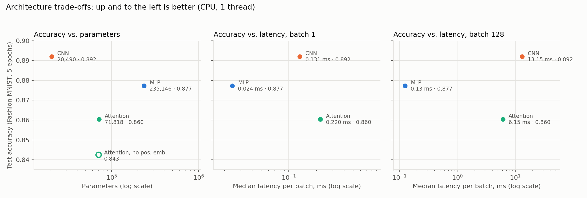

# Lab 3: Architectures and their costs

## 1. Goal

Implement an MLP, a CNN and a small patch-based Transformer for Fashion-MNIST in PyTorch, and compare them as systems: parameters, hand-calculated vs. profiled FLOPs, inference latency at batch 1 and batch 128, and test accuracy after the same training budget. Then use the data-access patterns of each architecture (Reddi Ch. 4.6–4.7) to decide which one is most cost-effective.

## 2. Method

**Environment.** Python 3.11.8, PyTorch 2.3.1 (versions in `results/versions.txt`), Apple M5 (4 performance + 6 efficiency cores). Training and the headline latency numbers are on CPU. Seeds are set for `random`, NumPy and PyTorch, and every model starts from `torch.manual_seed(42)`. All results are reproduced with `src/run_all.sh`.

**Data.** `torchvision.datasets.FashionMNIST` with `ToTensor()` and `Normalize((0.2860,), (0.3530,))`. The official 60k training set is split 55,000 / 5,000 into train and validation with `random_split` (seed 42). The official 10k test set is used for testing. Batch size is 128 throughout, and the training loader is shuffled with a seeded generator. The data downloads to `data/` (git-ignored) if missing.

**Models.** The MLP and the CNN are exactly as specified. The attention model is as specified, with one addition:

| Model | Architecture |
|---|---|
| MLP | Flatten 784 → Linear 256 → ReLU → Linear 128 → ReLU → Linear 10 |
| CNN | Conv 1→16 (3×3, pad 1) → ReLU → MaxPool 2 → Conv 16→32 (3×3, pad 1) → ReLU → MaxPool 2 → Flatten → Linear 1568→10 |
| Attention | 16 patches of 7×7 → Linear 49→64 **+ learnable positional embedding (16×64)** → 2 × TransformerEncoderLayer (d_model 64, 4 heads, FFN 128) → mean over patches → Linear 64→10 |

The manual does not mention position information. But self-attention followed by mean pooling is permutation-invariant: without a positional embedding, the model cannot tell which patch came from where in the image. I added the standard learnable embedding (1,024 parameters) and trained the version without it as an ablation (§3.4).

**Cost measurement.**
- **Parameters:** `torchinfo.summary` (full summaries in `results/torchinfo_*.txt`).
- **Hand FLOPs:** the Ch. 4 formulas, counting 2 FLOPs per multiply-accumulate in matrix products only. Biases, activations, pooling, softmax and normalisation are not counted.
  - Linear: 2·in·out per row.
  - Conv2d: 2·K²·C_in·C_out·H_out·W_out.
  - Attention: 2·seq·d·3d (QKV) + 2·seq²·d (QKᵀ) + 2·seq²·d (attention × V) + 2·seq·d·d (output projection), with seq = 16 and d = 64.
- **Profiled FLOPs:** `thop.profile` with batch 1. thop reports MACs, so its numbers are doubled before comparing.
- **Latency:** inference mode, real test images.
  - Batch 1: median of 100 runs. Batch 128: median of 20 runs. Each after 10 warm-up runs.
  - To make the protocol repeatable, each measurement was repeated 5 times independently, and I report the median of the 5 medians with their range.
  - The headline setting is **CPU, 1 thread**. With PyTorch's default 10 threads on this mixed-core chip, small-batch timings varied by more than 2× between repetitions (e.g. CNN batch 1: 0.088–0.196 ms). Single-threaded, repetitions agree within 2%, apart from one 14% outlier (attention, batch 128). CPU with 4 threads and MPS (the Apple GPU) are reported as supplements.

**Training.** Adam, lr 1e-3, batch 128, 5 epochs, cross-entropy loss. Validation accuracy is logged every epoch. The model after epoch 5 is evaluated once on the test set; there is no early stopping or model selection.

## 3. Results

### 3.1 Parameters (`results/params.csv`)

| Model | Parameters (torchinfo) | In the 100k–150k target? | fp32 weights |
|---|---|---|---|
| MLP | 235,146 | No (above) | 919 KB |
| CNN | 20,490 | No (below) | 80 KB |
| Attention | 71,818 | No (below) | 281 KB |

The architectures the manual specifies do not land in its own 100k–150k target. I kept the specified architectures rather than resizing them, so the parameter counts differ by up to 11×. This makes the comparison more informative, not less (§3.5).

- **MLP:** 85% of its parameters (200,960) sit in the first layer, 784→256.
- **CNN:** 77% of its parameters (15,690) sit in the final classifier. The two convolutions together hold only 4,800.
- **Attention:** 93% of its parameters are in the two encoder layers (33,472 each).

### 3.2 Hand-calculated vs. measured FLOPs

My handwritten calculations are in `results/hand_flops_page1.jpg` and `results/hand_flops_page2.jpg`.

**One layer of each type, profiled on its own** (`results/flops_representative_layers.csv`, per image):

| Type | Layer | Hand formula | Hand FLOPs | thop × 2 | Match |
|---|---|---|---|---|---|
| Linear | MLP 784→256 | 2 × 784 × 256 | 401,408 | 401,408 | exact |
| Conv2d | CNN 16→32, 3×3, 14×14 out | 2 × 3 × 3 × 16 × 32 × 14 × 14 | 1,806,336 | 1,806,336 | exact |
| Attention | Self-attention block, seq 16, d 64 | 2·16·64·192 + 2·16²·64 + 2·16²·64 + 2·16·64·64 | 589,824 | **0** | thop misses it entirely |

**Whole models** (`results/flops_totals.csv`, per image):

| Model | Hand FLOPs | thop default | thop, fast path off | thop, fast path off + MHA rule |
|---|---|---|---|---|
| MLP | 469,504 | 469,504 (100%) | 469,504 | 469,504 |
| CNN | 2,063,488 | 2,063,488 (100%) | 2,063,488 | 2,063,488 |
| Attention | 2,329,856 | 101,632 (**4.4%**) | 1,182,976 (50.8%) | 2,362,624 (101.4%) |

**Explaining the gaps.**
1. **MACs vs. FLOPs (factor 2).** thop counts multiply-accumulates. Once doubled, Linear and Conv2d match the formulas exactly. This thop version also ignores biases, ReLU and max-pooling, which is the same convention as the hand formulas.
2. **The encoder is invisible to thop by default (−95.6%).** `thop.profile` always runs the model under `eval()` and `no_grad()`. In exactly that state, PyTorch replaces each `TransformerEncoderLayer` with a single fused "fast path" kernel. That kernel never calls the layer's submodules, so none of thop's hooks fire. I confirmed this with a hook on the FFN's first Linear: it fired in training mode and never under eval + no_grad. Only the patch projection and the head are counted: 100,352 + 1,280 = 101,632.
3. **No rule for multi-head attention (−49%).** With the fast path disabled (`torch.backends.mha.set_fastpath_enabled(False)`), thop picks up the FFN and LayerNorm layers. It still counts zero for `nn.MultiheadAttention`, because there is no counting rule for it. Its QKV projection uses a raw weight tensor through a functional call, not an `nn.Linear` module, and QKᵀ and attention × V are plain matrix multiplications that no module wraps.
4. **After both fixes, +1.4% remains.** I added a custom thop rule for multi-head attention: QKV + QKᵀ + AV + output projection. The leftover 32,768 FLOPs are thop's count for the four LayerNorms (8 FLOPs per element on 16×64 tokens, 8,192 each). The hand formulas exclude normalisation.

**Where the attention model's FLOPs go** (hand count): FFN 45.0%, QKV projections 33.8%, output projections 11.3%, QKᵀ and AV together 5.6%, patch projection 4.3%. With only 16 tokens the quadratic seq² term is small. The model is dominated by its dense projections, so it behaves like a stack of small MLPs applied to 16 tokens.

### 3.3 Inference latency (`results/latency.csv`)

**Headline: CPU, 1 thread.** Median of 5 repetitions, with the range across repetitions in parentheses.

| Model | Batch 1 (ms) | Batch 128 (ms) | Per image at batch 128 (ms) | Achieved GFLOP/s, batch 1 | Achieved GFLOP/s, batch 128 |
|---|---|---|---|---|---|
| MLP | **0.024** (0.024–0.025) | **0.126** (0.125–0.128) | **0.001** | 19.2 | 478 |
| CNN | 0.131 (0.131–0.132) | 13.15 (12.94–13.31) | 0.103 | 15.7 | 20 |
| Attention | 0.220 (0.219–0.223) | 6.15 (6.10–7.02) | 0.048 | 10.6 | 48 |

Achieved GFLOP/s is the hand FLOPs × batch divided by the median latency.

**Supplementary settings** (median latency per batch, ms):

| Model | CPU 4 threads, b1 | CPU 4 threads, b128 | MPS, b1 | MPS, b128 |
|---|---|---|---|---|
| MLP | 0.024 | 0.124 | 0.420 | 0.432 |
| CNN | 0.069 | 8.59 | 0.453 | 0.771 |
| Attention | 0.286 | 6.10 | 2.450 | 5.936 |

The GPU is slower than the CPU at batch 1 for every model. It pays a fixed launch-and-synchronise cost of about 0.4 ms. At batch 128 it speeds the CNN up 17× over single-threaded CPU, but barely helps the attention model, which is made of many small kernels.

### 3.4 Test accuracy after 5 epochs (`results/test_accuracy.csv`, `results/train_log.csv`)

| Model | Parameters | Final val. accuracy | **Test accuracy** | Training time (5 epochs, CPU) |
|---|---|---|---|---|
| MLP | 235,146 | 0.8818 | 0.8772 | 16 s |
| CNN | 20,490 | 0.8972 | **0.8920** | 86 s |
| Attention | 71,818 | 0.8652 | 0.8604 | 75 s |
| Attention, no positional embedding (ablation) | 70,794 | 0.8522 | 0.8425 | 81 s |

The positional embedding adds 1.8 points of test accuracy for 1,024 parameters, which supports the design choice. These are single training runs. With 10k test images the sampling error of each accuracy is about ±0.3 points, so the CNN–MLP gap of 1.5 points is larger than test-set noise. Seed-to-seed variation was not measured.

### 3.5 Trade-off plots (`results/tradeoff.png`)

### 3.6 Which architecture is most cost-effective?

The three architectures sit at different corners of the trade-off space. The access patterns in Ch. 4.6–4.7 explain why:

- **MLP: dense, regular access, weights used once per image.** Every weight is read once per input and used for a single multiply-accumulate, which is 0.5 FLOP per byte of weights at batch 1. That is the textbook memory-bound pattern. On this chip, though, its 919 KB of weights fit in cache, and the whole model is just three large matrix products (GEMMs). That is the pattern optimised math libraries and the CPU's matrix units handle best.
  - At batch 128 each weight is reused 128 times, and throughput jumps to 478 GFLOP/s, 25× its batch-1 rate.
  - It is the fastest model in every CPU setting: 5–9× faster than the others at batch 1, and 49–104× faster at batch 128.
- **CNN: sliding-window access with high weight reuse.** Each 3×3 kernel is reused at every one of the 784 or 196 spatial positions. So the CNN does 4.4× the MLP's FLOPs with 1/11 of its parameters, about 25 FLOPs per byte of weights.
  - The cost moves from weights to activations. The first convolution writes a 16×28×28 feature map, 50 KB per image and 6.4 MB per batch of 128. That map is then re-read by the ReLU, the max-pool and the next convolution's sliding windows.
  - With only 1 and 16 input channels, the inner dot products are too short (9 and 144 terms) to keep the vector units busy. So it reaches only 16–20 GFLOP/s and is the slowest model at batch 128 on one CPU thread.
  - It is also the model that gains most from the GPU (17×), whose many cores and high memory bandwidth suit this regular, data-parallel access.
- **Attention: dynamic, data-dependent access spread over many small operations.** Each layer runs QKV projections, a split into 4 heads, 4 × (16×16) score matrices, softmax, a weighted sum, two LayerNorms and an FFN. That is a long chain of small kernels, each with its own memory traffic, tensor reshaping and dispatch overhead.
  - It has the lowest achieved throughput at batch 1 (10.6 GFLOP/s).
  - Here it is dominated on every axis: lower accuracy than the CNN, with 3.5× its parameters and 1.7× its batch-1 latency. Its strength, global interaction between distant patches, buys little on 28×28 images, and it typically needs more data and epochs than 5.

**Verdict.**
- **Overall: the CNN.** It is the most accurate (0.892) and has by far the fewest parameters. At 80 KB it would even pass the 100 KB TinyML model-size budget from Lab 1, which the 919 KB MLP would not.
- **CPU latency or throughput: the MLP.** If the cost that matters is CPU latency or throughput, the MLP wins. It gives up 1.5 accuracy points to be 5× faster at batch 1 and about 100× faster at batch 128 on one thread.
- **Attention:** not cost-effective at this scale.

## 4. Conclusions

1. Parameter count and FLOPs are two different things. The CNN has a lot fewer parameters than the MLP, but it computes a lot more. The MLP has about 11.5 times more parameters than the CNN (235,146 vs 20,490), but the CNN has about 4.4 times more FLOPs than the MLP (2,063,488 vs 469,504). This is because the CNN uses the same kernel at every position of the image, while the MLP uses each weight only once per image. So the two have to be measured separately: parameter count decides how much storage the model needs, and FLOPs decide how long it takes to compute.
2. We cannot fully trust thop. For standard layers like Linear and Conv2d its results can be trusted, but for complex layers like attention it counts much less than the real number. For Linear and Conv2d, thop matched my hand calculation exactly, but for the attention model it only counted 4.4% of my hand calculation (101,632 vs 2,329,856). There are two reasons. First, PyTorch takes a shortcut (the "fast path"): in inference mode, to run faster, it merges the whole Transformer layer into one big operation, so it never goes through the smaller layers inside and thop's counters never run. That is why the Transformer part was counted as 0. Second, even without this shortcut, thop has no counting rule for MultiheadAttention, and the matrix multiplications inside it are not separate layers, so thop still cannot count them. So engineers should not just trust the numbers from profiling tools. Especially for new and complex layers, they should check the results with a hand calculation.
3. FLOPs cannot directly predict speed: a model with fewer FLOPs is not always faster. On one CPU thread at batch 128, the CNN has fewer FLOPs than the attention model (2,063,488 vs 2,329,856) but is about 2 times slower (13.15 ms vs 6.15 ms). The CNN also has 4.4 times more FLOPs than the MLP, but takes about 100 times longer (13.15 ms vs 0.13 ms). The MLP has the fewest FLOPs, and it is only 3 big matrix multiplications, which the CPU can run very efficiently. The CNN slides a small 3×3 window over the image, computes only a little each time and then has to move data, so it has the lowest efficiency (about 20 GFLOP/s, against 48 GFLOP/s for attention). That is why it takes longer than attention even with fewer FLOPs. The attention model is many small operations chained together. So to know how fast a model really is, we have to measure it on real hardware.
